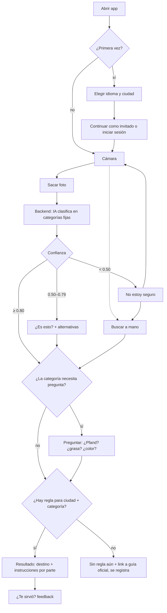

# Lógica de respuesta

Cómo una foto se convierte en "esto va acá y así".

## Principio central

**La IA clasifica, la base de datos decide.**

- El modelo de visión solo dice *qué es* el objeto, eligiendo de una lista cerrada de categorías.
- *Dónde va* lo decide siempre una regla escrita por nosotros en la base de datos, según la combinación categoría + ciudad.
- El modelo nunca inventa un tacho.

## Paso a paso

### 1. Entrada

La app envía al backend:
- la foto
- `city_id` (guardada en el teléfono, también para invitados)
- el idioma (`de` / `en` / `es`)

### 2. Clasificación

El backend llama al modelo de visión. En el prompt van:
- la lista de categorías permitidas (`key` + descripción corta)
- la exigencia de responder en JSON estructurado

```json
{
  "parts": [
    { "category": "envase_plastico", "label": "vaso de yogur", "confidence": 0.92 },
    { "category": "aluminio",        "label": "tapa",          "confidence": 0.88 }
  ],
  "alternatives": ["vidrio_blanco"]
}
```

- `parts` existe porque muchos objetos son compuestos: vaso con tapa, caja con ventana de plástico. La respuesta se da por parte, por ejemplo "separá la tapa".
- Si el modelo devuelve una categoría que no está en la lista, se trata como confianza 0.
- La foto **no se guarda**: se analiza y se descarta.

### 3. Decisión por confianza

Se toma la confianza más baja entre las partes.

| Confianza | Qué hace la app |
|---|---|
| ≥ 0.80 | Respuesta directa |
| 0.50 – 0.79 | "¿Es esto?" con la mejor opción + 2 alternativas para tocar |
| < 0.50 o sin categoría | "No estoy seguro": sacar otra foto o buscar a mano |

Los umbrales son un punto de partida. Se ajustan con los datos del paso 7.

### 4. Pregunta de aclaración

Algunas categorías dependen de algo que no se ve en la foto. Esas categorías tienen una pregunta asociada, y cada opción apunta a una subcategoría. Ejemplos:

| Categoría | Pregunta | Opciones → subcategoría |
|---|---|---|
| `botella_bebida_plastico` | ¿Tiene símbolo de Pfand? | sí → `pfand` · no → `envase_plastico` |
| `caja_pizza` | ¿Está muy sucia de grasa? | sí → `resto_general` · no → `papel_carton` |
| `vidrio_envase` | ¿De qué color es? | blanco / verde / marrón |

La lista completa de categorías y preguntas está en [categories.md](categories.md).

### 5. Búsqueda de la regla

Se consulta `rules(city_id, category_id)`:

- **Hay regla:** se muestra el destino, las instrucciones en el idioma del usuario y una nota opcional, por ejemplo "enjuagar no hace falta".
- **No hay regla para esa ciudad:** no se adivina con una regla nacional. Se muestra "Todavía no tenemos esta regla para tu ciudad" y un link a la guía oficial de la ciudad. El caso se registra para cargar la regla después.

### 6. Destinos, no solo tachos

En Alemania no todo va a un tacho. Por eso el destino tiene un tipo:

| `type` | Ejemplos |
|---|---|
| `bin` | Gelbe Tonne / Wertstofftonne, Bio, Papier, Restmüll |
| `public_container` | contenedores de vidrio, ropa usada |
| `store_return` | Pfand, pilas, pequeños electrónicos |
| `recycling_center` | Wertstoffhof |
| `hazardous` | punto o camión de residuos peligrosos |
| `bulky_pickup` | Sperrmüll (se pide turno) |

Cada ciudad tiene sus propios destinos. Por ejemplo, Berlín usa Wertstofftonne, que acepta más que envases. Hay que verificarlo contra la guía oficial de cada ciudad.

### 7. Feedback

Debajo de la respuesta aparece "¿Te sirvió? 👍 / 👎 / Era otra cosa".

Se guarda, sin la foto:
- categoría predicha
- confianza
- corrección del usuario
- ciudad

Con esto se ajustan los umbrales y se detectan reglas faltantes.

## Búsqueda manual

Es el plan B cuando la foto falla, y también un camino propio para quien prefiere escribir. Las guías oficiales (Abfall-ABC) ya son listas de objeto → destino, así que se cargan como alias:

`item_aliases(text, lang, category_id)`

Por ejemplo, "Joghurtbecher", "yogurt cup" y "vaso de yogur" apuntan todos a la misma categoría.

## Modelo de datos

```
cities           (id, name, official_guide_url)
categories       (id, key, description)                 -- taxonomía que ve la IA
category_questions (category_id, question jsonb)         -- textos de/en/es
question_options (question_id, label jsonb, sub_category_id)
destinations     (id, city_id, type, key, name jsonb, color)
rules            (city_id, category_id, destination_id, instructions jsonb, note jsonb)
item_aliases     (text, lang, category_id)
feedback         (id, created_at, city_id, predicted_category_id, confidence,
                  verdict, corrected_category_id, user_id NULL)
users            (id, ...)                               -- opcional, solo si inicia sesión
```

- Los textos traducibles van como `jsonb` (`{"de": "...", "en": "...", "es": "..."}`).
- Los invitados no tienen fila en `users`. La ciudad y el historial quedan en el teléfono.

## Fuentes de reglas (ciudades de lanzamiento)

- **Köln:** AWB Köln (Abfallwirtschaftsbetriebe Köln)
- **Düsseldorf:** AWISTA
- **Berlín:** BSR (Berliner Stadtreinigung)

## Flujo


